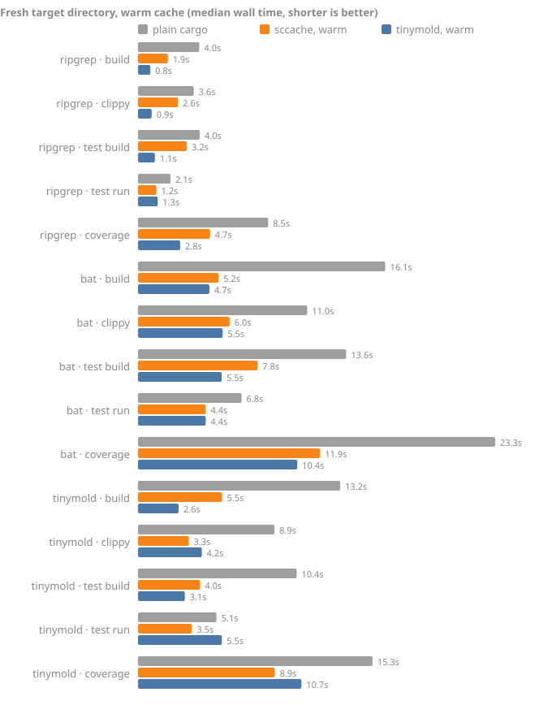

# tinymold

tinymold is a fast content-addressed build cache: one server and one store,
with adapters for each ecosystem's cache protocol. Rust gets the deepest
integration, through a rustc wrapper that caches every compile by content.
Turborepo, Nx, Gradle, ccache, Bazel and Go are served through their own
remote-cache protocols ([ADR 0009](docs/adr/0009-a-cache-server-with-protocol-front-ends.md)).
In the spirit of [mold](https://github.com/rui314/mold): measure where the
time goes, then remove that work rather than doing it slightly faster.

## Every cargo command, from cache

Developers, CI jobs and coding agents run the same four commands over and
over: `cargo build`, `cargo clippy`, `cargo test` and `cargo llvm-cov`. Each
builds its own flavor of the dependency graph, and each starts from scratch
in a fresh CI runner, a new worktree or after a `cargo clean`. tinymold
caches all four.

Below, each command runs in a fresh `target/` directory, once with plain
cargo and once with tinymold's store already warm: what a CI job sees after
restoring its cache, or a second worktree on the same machine.

<!-- commands:start -->

| Project | Command | plain cargo | tinymold, warm cache | speed-up |
| --- | --- | ---: | ---: | ---: |
| ripgrep 14.1.1 | `build` | 3.99s | 0.81s | 5.0× |
| ripgrep 14.1.1 | `clippy` | 3.64s | 0.89s | 4.1× |
| ripgrep 14.1.1 | `test build` | 4.02s | 1.10s | 3.7× |
| ripgrep 14.1.1 | `test run` | 2.12s | 1.29s | not cached |
| ripgrep 14.1.1 | `coverage` | 8.48s | 2.75s | 3.1× |
| bat v0.24.0 | `build` | 16.13s | 4.66s | 3.5× |
| bat v0.24.0 | `clippy` | 11.03s | 5.52s | 2.0× |
| bat v0.24.0 | `test build` | 13.57s | 5.46s | 2.5× |
| bat v0.24.0 | `test run` | 6.75s | 4.42s | not cached |
| bat v0.24.0 | `coverage` | 23.29s | 10.39s | 2.2× |
| tinymold 2b41d65 | `build` | 13.19s | 2.65s | 5.0× |
| tinymold 2b41d65 | `clippy` | 8.90s | 4.16s | 2.1× |
| tinymold 2b41d65 | `test build` | 10.35s | 3.05s | 3.4× |
| tinymold 2b41d65 | `test run` | 5.12s | 5.46s | not cached |
| tinymold 2b41d65 | `coverage` | 15.29s | 10.66s | 1.4× |

Median of 3 runs on darwin arm64, 18 CPUs, rustc 1.99.0 (b940084d7 2026-09-28), 2026-10-15; generated by `bench/report.py` from [`bench/results/commands-darwin-arm64.json`](bench/results/commands-darwin-arm64.json).



<!-- commands:end -->

`test run` here is plain `cargo test` executing the tests. Set
`tinymold run-test` as cargo's runner and a run whose test binary and inputs
did not change is replayed instead: an unchanged `cargo test` on ripgrep went
from 1.29s to 0.09s ([retest benchmark](bench/README.md#results)). Cold runs,
sccache, and how each case is measured are in
[`bench/COMMANDS.md`](bench/COMMANDS.md); reproduce them with
`python3 bench/bench.py commands`.

## Install

```sh
cargo install tinymold
tinymold doctor        # host, toolchain, store, fast linkers on PATH
```

Prebuilt binaries for Linux, macOS, and Windows (x86_64 and ARM64) are attached
to each [GitHub release](https://github.com/tinyhumansai/tinymold/releases).

## Use it

**On your machine**, turn it on for every cargo command, and replay
unchanged test runs:

```toml
# ~/.cargo/config.toml, or .cargo/config.toml in a project
[build]
rustc-wrapper = "tinymold"

[target.'cfg(all())']
runner = ["tinymold", "run-test"]
```

Every worktree, branch and agent sandbox on the machine then shares one
store, so a second checkout of the same commit builds from cache.

**In GitHub Actions**, add two steps around your cargo commands:

```yaml
steps:
  - uses: actions/checkout@v7
  - uses: dtolnay/rust-toolchain@stable
  - uses: tinyhumansai/tinymold@v0          # RUSTC_WRAPPER + restore the store
  - run: cargo clippy --all-targets -- -D warnings
  - run: cargo test --all-features
  - run: cargo llvm-cov --workspace --lcov --output-path lcov.info
  - uses: tinyhumansai/tinymold/save@v0     # gc, hit-rate summary, save
    if: always()
```

The store travels in GitHub's own cache, so no server is needed, and cargo's
crate downloads get a cache entry of their own, keyed by `Cargo.lock`.
Self-hosted runners keep a persistent store instead (`backend: none`), and
many repositories or runners can share a
[bazel-remote](deploy/bazel-remote/README.md) server (`backend: remote`).
Inputs, cache keys and runners are in
[`docs/specs/github-actions.md`](docs/specs/github-actions.md), and the remote
tier in [`docs/specs/remote.md`](docs/specs/remote.md).

**For Turborepo, Nx, ccache or Go in the same job**, add `serve: true`: the
action runs `tinymold serve` on loopback for the job, points those tools at
it, and carries its store in the same GitHub cache entry. No Rust toolchain
is needed for that.

```yaml
  - uses: tinyhumansai/tinymold@v0
    with:
      serve: true
  - run: npm ci && npx turbo run build test
  - uses: tinyhumansai/tinymold/save@v0
    if: always()
```

**Anywhere else** (GitLab, Buildkite, Jenkins, custom runners), set
`RUSTC_WRAPPER=tinymold`, cache the `TINYMOLD_STORE` directory between jobs,
and run `tinymold gc` before saving it.

**Coding agents:** [`llms.txt`](llms.txt) is a step-by-step integration guide
for all of the above, written for an agent to follow.

## More commands

```sh
# See what the cache did.
TINYMOLD_LOG=/tmp/tm.log cargo build
tinymold stats --log /tmp/tm.log           # hits, misses and time

# Keep the store bounded (the wrapper also collects in the background).
tinymold gc --max-age 14d --max-size 20G

# Start a new worktree warm, and survive branch switches.
tinymold snapshot save                     # in the worktree you built
tinymold snapshot restore                  # in a new worktree, before cargo build
tinymold snapshot restore --replace        # after a branch switch
tinymold fresh restore                     # after a checkout: undo mtime-only changes

# The store itself.
tinymold hash src/main.rs                  # BLAKE3 digests, b3sum format
tinymold cas put target/debug/deps/libfoo-*.rlib

# The cache server, for every other build tool.
tinymold serve                             # http://127.0.0.1:9090, store in tinymold-server/
CCACHE_REMOTE_STORAGE="http://127.0.0.1:9090|layout=bazel" ccache cc -c unit.c
TURBO_API=http://127.0.0.1:9090 TURBO_TOKEN=local TURBO_TEAM=me npx turbo run build
NX_SELF_HOSTED_REMOTE_CACHE_SERVER=http://127.0.0.1:9090 npx nx run-many -t build
# Gradle: remote<HttpBuildCache> { url = uri("http://127.0.0.1:9090/gradle/") }
# Bazel:  --remote_cache=grpc://127.0.0.1:9090
GOCACHEPROG="tinymold gocacheprog" go build ./...   # Go, straight from the store
```

`tinymold serve` is specified in
[`docs/specs/cache-server.md`](docs/specs/cache-server.md); against bazel-remote
it serves 4 MiB blobs about 1.4× faster and starts in 17 ms whatever the store
holds ([benchmark](bench/README.md#results)).

The store defaults to `$TINYMOLD_STORE`, then `$XDG_CACHE_HOME/tinymold`, then
`~/.cache/tinymold`. Keep it on the same filesystem as your checkouts: that is
what lets a restore be a reflink or hardlink instead of a copy. Every hit
records when an entry was last used, and `gc` expires by that
([`docs/specs/gc.md`](docs/specs/gc.md)).

`tinymold run-test` keys a run by the test binary's digest, its arguments,
the files under its package, and its environment, and replays only passes
([`docs/specs/test-cache.md`](docs/specs/test-cache.md)). A package whose
tests read files outside it declares them under
`[package.metadata.tinymold.test]`, or opts out with `cache = false`.

The wrapper is specified in
[`docs/specs/rustc-wrapper.md`](docs/specs/rustc-wrapper.md); set
`TINYMOLD_LOG=<file>` to see a `hit`/`miss` line per compile, or
`TINYMOLD_TRACE=<file>` for a Chrome trace event per wrapper step (see
[`bench/PROFILING.md`](bench/PROFILING.md)). `TINYMOLD_MAX_EXECUTABLE_SIZE=256M`
leaves compiles with a larger executable output (big test binaries) unstored,
so they are relinked rather than doubling the disk a build needs where the
store cannot share blocks with `target/`. `fresh` and `snapshot` are
specified in [`docs/specs/freshness.md`](docs/specs/freshness.md).

For the edit loop itself, set `codegen-units = 64` under `[profile.dev]`. In
interleaved A/B runs it made every edit kind 13-21% faster on ripgrep and bat
than cargo's incremental default of 256
([details](docs/plans/edit-loop.md)).

## Why it is fast

**A hit costs a clone, not a copy.** tinymold stores each artifact once, named
by its BLAKE3 digest, and restores it with a copy-on-write clone where the
filesystem supports one (APFS, btrfs, XFS). Restoring a 512 MiB artifact on an
M-series Mac:

| Method | Median |
| --- | ---: |
| Byte copy | 223.4 ms |
| `tinymold cas get` (reflink) | 3.5 ms |
| `tinymold cas get` (hardlink) | 2.9 ms |

**Keys are content, not paths or times.** Two worktrees at different paths,
or a checkout that touched every mtime, produce the same keys, so they share
every entry ([cache-key spec](docs/specs/cache-key.md)). On ripgrep, a second
worktree of the same commit builds in 0.08s instead of 3.39s, and a branch
switch A→B→A in 0.43s instead of 1.18s ([scenarios](bench/README.md#results)).

**It caches what other caches skip.** sccache refuses incremental builds and
skips binaries and proc-macros. tinymold caches every rustc call cargo makes,
`clippy-driver` with its lints replayed, the instrumented compiles of
`cargo llvm-cov`, and passing test runs.

**It never trades correctness for speed.** Anything that is an input is in the
key; anything that is not stays out. Objects are immutable once stored, and remote blobs are checked against their
digests. Use trusted signing keys to authenticate remote records: a writer
without that protection can poison build outputs despite valid hashes. See
[cache security](docs/specs/cache-security.md) before sharing a cache with
public pull-request jobs. When in doubt, tinymold misses.

The cache never links for you: a binary that depends on the crate you edited
is still relinked in full, while unchanged crates, binaries and test
executables are restored without compiling or linking. Every benchmark, the
machine it ran on, and how to reproduce it are in [`bench/`](bench/README.md).

> **Status: a working cache.** The content-addressed store, the hashing
> layer, the rustc wrapper (`RUSTC_WRAPPER=tinymold`), the test result cache
> (`tinymold run-test`), `fresh`, `snapshot`, `gc` and the REAPI remote tier
> work today, and so does `tinymold serve` with its REAPI, Bazel HTTP,
> Turborepo, Nx and Gradle front-ends and the Go adapter. See the
> [cache-server plan](docs/plans/cache-server.md) for what remains.

## How it works

```text
 Turbo   Nx   Gradle   ccache   Bazel/Buck2   rustc wrapper   go (GOCACHEPROG)
   └──────┴──────┴────────┴──────────┴──────────────┴──────────────┘
                                  │ each speaks its own protocol
                                  ▼
          tinymold serve: front-ends (Turbo, Nx, Gradle, Bazel HTTP, REAPI, native)
                                  │
          tinymold-store: namespaces, ActionCache, BLAKE3 ↔ SHA-256 index, LRU budget
                                  │
          tinymold-cas: immutable objects by BLAKE3, reflink/hardlink restore
```

- **One store for every language.** Each toolchain keeps computing its own
  keys; the server stores and serves the results, and identical bytes are
  stored once whichever protocol they arrived through.
- **Runs anywhere.** On a developer machine, as a shared service, or inside a
  GitHub Actions job on `localhost` with the store carried in `actions/cache`.
- **Rust goes deeper.** The rustc wrapper caches every unit by content, with
  path normalization so worktrees at different paths share artifacts
  ([cache-key spec](docs/specs/cache-key.md)), and replays passing test runs.
- **Hashing:** BLAKE3-256 for anything stored or shared
  ([ADR 0002](docs/adr/0002-blake3-for-content-digests.md)), and a stat cache so
  unchanged files are never read at all.

The server design is in [`docs/specs/cache-server.md`](docs/specs/cache-server.md),
the Rust side in [`docs/specs/architecture.md`](docs/specs/architecture.md), and
the reasoning, with sources, in [`docs/research/`](docs/research/README.md).

## Crates

| Crate | What it is |
| --- | --- |
| [`tinymold`](crates/tinymold) | The `tinymold` binary and its library half |
| [`tinymold-cas`](crates/tinymold-cas) | Local content-addressed store: atomic insert, read-only objects, reflink → hardlink → copy restore |
| [`tinymold-server`](crates/tinymold-server) | `tinymold serve`: one store behind REAPI v2 (tinymold, Bazel, Buck2), Bazel's HTTP cache protocol (and ccache), Turborepo, Nx and Gradle's HTTP build cache |
| [`tinymold-store`](crates/tinymold-store) | The cache server's core: namespaced entries over the CAS, and a SHA-256 index so every protocol finds the same blob |
| [`tinymold-hash`](crates/tinymold-hash) | The BLAKE3-256 `Digest` type, streaming file hashing, and a field hasher for cache keys |
| [`tinymold-key`](crates/tinymold-key) | rustc argument parsing, path roots, dep-info, and the two cache keys |
| [`tinymold-wrap`](crates/tinymold-wrap) | The `RUSTC_WRAPPER`: lookup, restore, run and store, plus the record catalog GC uses |
| [`tinymold-remote`](crates/tinymold-remote) | The remote tier: a hand-written REAPI v2 client for bazel-remote and other caches |

All crates release together under one version and are published to
[crates.io](https://crates.io/crates/tinymold).

## Development

```sh
cargo fmt --all -- --check
cargo clippy --all-targets --all-features -- -D warnings
cargo build --all-targets --all-features
cargo test --all-features
cargo run -p tinymold --example basic
```

Those four checks are exactly what CI runs. CI also requires at least 90% line
coverage in every source file, builds rustdoc with `-D warnings`, checks the
MSRV, runs `cargo deny`, and packages every crate for crates.io.
[`AGENTS.md`](AGENTS.md) (symlinked as `CLAUDE.md`) is the full guide for
humans and coding agents working on tinymold itself.

## Documentation

- [`llms.txt`](llms.txt): integrating tinymold into a project, for coding agents
- [`docs/research/`](docs/research/README.md): what mold, wild, Bun, Zig, Go,
  Bazel, Buck2, Scion, and rustc teach about build speed, with sources
- [`docs/specs/cache-server.md`](docs/specs/cache-server.md) and
  [`docs/specs/architecture.md`](docs/specs/architecture.md): the target design
- [`docs/specs/cache-key.md`](docs/specs/cache-key.md): what goes into a rustc
  cache key, and what breaks reuse
- [`docs/plans/roadmap.md`](docs/plans/roadmap.md): the phased delivery plan
- [`docs/adr/`](docs/adr/): architecture decision records
- [`bench/`](bench/README.md): benchmarks, results, and how to reproduce them

## License

GPL-3.0-only. See [LICENSE](LICENSE).
