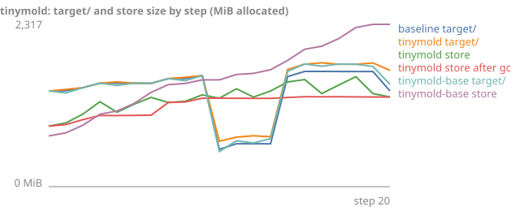
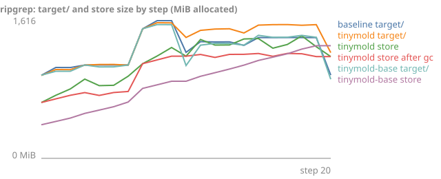
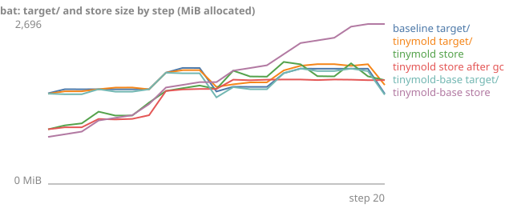
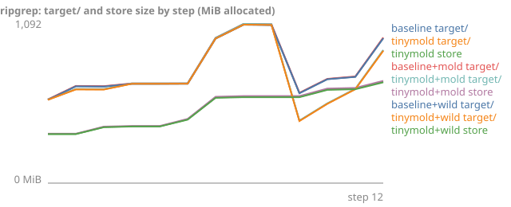

# Edit-sequence results

Generated by `python3 bench/report.py` from `bench/results/edits-*.json`; do not
edit by hand. The benchmark is `python3 bench/bench.py edits` (see
[`edits.py`](edits.py)), and what it measures is specified in
[`docs/specs/edit-rebuild.md`](../docs/specs/edit-rebuild.md).

### Edit sequence (darwin arm64, 18 CPUs, rustc 1.99.0 (b940084d7 2026-09-28), 1 runs, 2026-10-15)

20 cumulative steps per project (comment, private_body, public_signature in turn; churn every 7 steps; fresh target every 10 steps; gc --keep-generations 3 after each step), each followed by: build, clippy, test, coverage. Latency cells are medians over the edit steps; *after fresh* is the first edit after the target directory was deleted with the store kept. Sizes are allocated blocks with each inode counted once, so reflinked files count in full; growth is per step after the warm-up build. Peak RSS is the largest single process (rustc, linker or wrapper) of any command.

| Project | Mode | build | clippy | test build | test run | coverage | fresh build | after fresh |
| --- | --- | ---: | ---: | ---: | ---: | ---: | ---: | ---: |
| tinymold 072d80f | baseline | 0.60s | 0.38s | 0.52s | 5.04s | 6.18s | 14.28s | 0.79s |
| tinymold 072d80f | tinymold | 0.64s | 0.40s | 0.66s | 5.09s | 6.16s | 9.30s | 0.79s |
| tinymold 072d80f | tinymold-base | 0.66s | 0.41s | 0.65s | 5.04s | 6.48s | 7.03s | 1.22s |
| ripgrep 14.1.1 | baseline | 0.91s | 0.69s | 0.59s | 2.48s | 5.36s | 5.25s | 0.79s |
| ripgrep 14.1.1 | tinymold | 0.91s | 0.63s | 0.57s | 2.02s | 4.60s | 2.36s | 0.86s |
| ripgrep 14.1.1 | tinymold-base | 1.06s | 0.62s | 0.55s | 2.13s | 4.97s | 2.50s | 1.94s |
| bat v0.24.0 | baseline | 1.12s | 0.71s | 0.82s | 6.19s | 7.93s | 13.54s | 1.14s |
| bat v0.24.0 | tinymold | 0.99s | 0.64s | 0.50s | 3.87s | 6.97s | 9.92s | 2.01s |
| bat v0.24.0 | tinymold-base | 0.89s | 0.75s | 0.53s | 3.84s | 5.94s | 10.29s | 1.83s |

| Project | Mode | target/ final | target/ per step | incremental final | coverage final | store final | store per step | store after gc | peak RSS |
| --- | --- | ---: | ---: | ---: | ---: | ---: | ---: | ---: | ---: |
| tinymold 072d80f | baseline | 1,366 MiB | 0 MiB | 235 MiB | 647 MiB | – | – | – | 425 MiB |
| tinymold 072d80f | tinymold | 1,660 MiB | 15 MiB | 224 MiB | 768 MiB | 1,280 MiB | 21 MiB | 1,280 MiB | 416 MiB |
| tinymold 072d80f | tinymold-base | 1,460 MiB | 5 MiB | 25 MiB | 663 MiB | 2,317 MiB | 80 MiB | – | 422 MiB |
| ripgrep 14.1.1 | baseline | 977 MiB | 0 MiB | 377 MiB | 520 MiB | – | – | – | 390 MiB |
| ripgrep 14.1.1 | tinymold | 1,241 MiB | 13 MiB | 360 MiB | 586 MiB | 1,194 MiB | 27 MiB | 1,194 MiB | 388 MiB |
| ripgrep 14.1.1 | tinymold-base | 929 MiB | -2 MiB | 49 MiB | 420 MiB | 1,322 MiB | 46 MiB | – | 386 MiB |
| bat v0.24.0 | baseline | 1,520 MiB | -0 MiB | 206 MiB | 674 MiB | – | – | – | 332 MiB |
| bat v0.24.0 | tinymold | 1,668 MiB | 7 MiB | 188 MiB | 709 MiB | 1,749 MiB | 41 MiB | 1,749 MiB | 331 MiB |
| bat v0.24.0 | tinymold-base | 1,505 MiB | -1 MiB | 25 MiB | 620 MiB | 2,696 MiB | 95 MiB | – | 333 MiB |

### Edit sequence (linux aarch64, 12 CPUs, rustc 1.99.0 (b940084d7 2026-09-28), 1 runs, 2026-10-14)

12 cumulative steps per project (comment, private_body, public_signature in turn; churn every 6 steps; fresh target every 9 steps), each followed by: build, clippy, test. Latency cells are medians over the edit steps; *after fresh* is the first edit after the target directory was deleted with the store kept. Sizes are allocated blocks with each inode counted once, so reflinked files count in full; growth is per step after the warm-up build. Peak RSS is the largest single process (rustc, linker or wrapper) of any command.

| Project | Mode | build | clippy | test build | test run | coverage | fresh build | after fresh |
| --- | --- | ---: | ---: | ---: | ---: | ---: | ---: | ---: |
| ripgrep 14.1.1 | baseline | 1.22s | 0.33s | 0.72s | 0.72s | – | 4.18s | 1.31s |
| ripgrep 14.1.1 | tinymold | 1.00s | 0.33s | 0.78s | 0.64s | – | 0.19s | 2.51s |
| ripgrep 14.1.1 | baseline+mold | 0.39s | 0.31s | 0.33s | 0.72s | – | 3.13s | 0.52s |
| ripgrep 14.1.1 | tinymold+mold | 0.44s | 0.27s | 0.35s | 0.72s | – | 0.17s | 1.25s |
| ripgrep 14.1.1 | baseline+wild | 0.39s | 0.35s | 0.35s | 0.72s | – | 3.24s | 0.67s |
| ripgrep 14.1.1 | tinymold+wild | 0.38s | 0.35s | 0.35s | 0.67s | – | 0.33s | 1.64s |

| Project | Mode | target/ final | target/ per step | incremental final | coverage final | store final | store per step | store after gc | peak RSS |
| --- | --- | ---: | ---: | ---: | ---: | ---: | ---: | ---: | ---: |
| ripgrep 14.1.1 | baseline | 994 MiB | 35 MiB | 501 MiB | 0 MiB | – | – | – | 406 MiB |
| ripgrep 14.1.1 | tinymold | 909 MiB | 28 MiB | 414 MiB | 0 MiB | 695 MiB | 30 MiB | – | 432 MiB |
| ripgrep 14.1.1 | baseline+mold | 998 MiB | 35 MiB | 501 MiB | 0 MiB | – | – | – | 430 MiB |
| ripgrep 14.1.1 | tinymold+mold | 913 MiB | 28 MiB | 414 MiB | 0 MiB | 701 MiB | 30 MiB | – | 451 MiB |
| ripgrep 14.1.1 | baseline+wild | 993 MiB | 35 MiB | 501 MiB | 0 MiB | – | – | – | 434 MiB |
| ripgrep 14.1.1 | tinymold+wild | 907 MiB | 28 MiB | 414 MiB | 0 MiB | 691 MiB | 30 MiB | – | 485 MiB |

