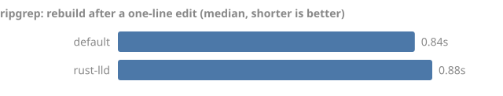
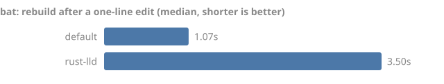

# Benchmarks

tinymold exists to make Rust builds faster and smaller, so every claim it makes
has to come with a number anyone can reproduce. This directory holds the
harness, the corpus it builds, and the results it has produced.

Six benchmarks exist today. All of them measure plain cargo, sccache, or the
store alone, so together they are the baseline every later phase has to beat:

- **`scenarios`**: the full edit-loop matrix, and the main scoreboard. For
  every corpus project and every mode (`baseline`, `sccache`, and `tinymold`
  once its rustc wrapper exists), it runs eight cases:
  - a clean build;
  - a no-op rebuild;
  - a comment edit;
  - a private function body edit;
  - a public signature edit;
  - a second worktree of the same commit;
  - a branch switch A→B→A;
  - `cargo test --no-run`.

  For each case it records wall time (median, min, max), link time from a tiny
  timing linker wrapper the harness installs, units compiled versus fresh (from
  `cargo build -v`), `target/` bytes split by kind, and cache hits.
- **`dedup`**: builds two worktrees of each project and reports how much of the
  second's `target/` is byte-identical to the first's at three levels: whole
  files, rlib members, and DWARF sections split out of object files. The gap
  between levels is what chunk-level storage could save beyond whole-file
  dedup.
- **`baseline`**: plain cargo, default linker, no cache. Per corpus project: a
  clean build, a no-op rebuild, a one-line edit, an mtime-only change to every
  source file (what a branch switch or a cache restore does to cargo), building
  the tests, and a clean build in a second worktree at another path. It also
  measures `target/` size and how many of the second worktree's artifact bytes
  are identical to the first's, which is what a shared store would dedupe.
- **`cache`**: clean builds with a compile cache. No cache, then an empty cache
  (the dry run that fills it), then the warm cache (the cached run), then the
  warm cache from a second worktree at another path. The cache is
  [sccache](https://github.com/mozilla/sccache), today's reference, which
  tinymold's cache has to beat on hit rate and wall time.
- **`link`**: the edit loop per linker. Append a comment to one source file and
  rebuild, once per linker available on the machine. That edit recompiles the
  leaf crate and relinks the whole binary, and on ripgrep about half of that
  rebuild is the linker
  ([research](../docs/research/linkers.md#3-what-fraction-of-a-rust-build-is-link-time)).
- **`cas`**: the cost of a cache hit. Restore one large artifact into a fresh
  path: a plain byte copy against `tinymold cas get` by reflink, hardlink, and
  copy. A hit only beats a rebuild if restoring doesn't copy bytes.

## Results

Generated by `bench/report.py` from the JSON files in [`results/`](results/).
Each heading lists the machine and toolchain the numbers came from. A number
without its machine is not a result.

<!-- results:start -->

### Edit-loop scenarios (darwin arm64, 18 CPUs, rustc 1.99.0 (b940084d7 2026-09-28), 1 runs, 2026-10-14)

Pinned: cargo build jobs: 18; target filesystem: apfs; linker: cc, rustc's default, behind a timing wrapper; linker threads: linker default; the platform cc linker takes no thread flag; output reuse: rustc default: each link writes a fresh output; incremental: on for baseline; off under sccache, which refuses it.

Each cell: median wall time, then median link time, then units compiled. Under sccache, `hits` counts rustc invocations served from the cache across all runs.

#### tinymold 85f8ef5 (this repository, as a small workspace)

| Case | baseline | sccache |
| --- | ---: | ---: |
| Clean build | 6.21s · link 0.33s · 30 compiled | 3.85s · link 0.29s · 30 compiled · 0/31 hits · first (cold) run 3.85s |
| No-op rebuild | 0.07s · link 0.00s · 0 compiled | 0.04s · link 0.00s · 0 compiled |
| Comment edit | 0.16s · link 0.04s · 1 compiled | 0.14s · link 0.04s · 1 compiled |
| Private function body edit | 0.27s · link 0.04s · 1 compiled | 0.32s · link 0.04s · 1 compiled · 0/1 hits |
| Public signature edit | 0.37s · link 0.04s · 3 compiled | 0.55s · link 0.04s · 3 compiled · 0/3 hits |
| Second worktree, same commit | 4.30s · link 0.26s · 30 compiled | 3.28s · link 0.26s · 30 compiled · 26/31 hits |
| Branch switch A→B→A | 0.72s · link 0.08s · 6 compiled | 0.48s · link 0.07s · 6 compiled · 6/6 hits |
| cargo test --no-run | 3.82s · link 0.25s · 9 compiled | 1.96s · link 0.28s · 9 compiled · 0/8 hits |

`target/` by kind (baseline):

| After | rlib | rmeta | debuginfo | objects | incremental | executables | other | total |
| --- | ---: | ---: | ---: | ---: | ---: | ---: | ---: | ---: |
| Clean build | 45 MiB | 8 MiB | 0 MiB | 46 MiB | 11 MiB | 24 MiB | 0 MiB | 134 MiB |
| cargo test --no-run | 54 MiB | 14 MiB | 0 MiB | 55 MiB | 23 MiB | 37 MiB | 0 MiB | 183 MiB |

### Baseline: plain cargo, default linker (darwin arm64, 18 CPUs, rustc 1.99.0 (b940084d7 2026-09-28), 5 runs, 2026-10-14)

What every tinymold phase is measured against. Times are wall clock; loops report the median.

| Scenario | ripgrep 14.1.1 | bat v0.24.0 |
| --- | ---: | ---: |
| Clean build | 3.5s | 21.6s |
| No-op rebuild | 0.07s | 0.10s |
| One-line edit → rebuilt binary | 0.52s | 0.75s |
| Every source file touched, no content change | 0.84s | 0.91s |
| Build tests (after the binary) | 3.3s | 4.6s |
| Second worktree, same commit, clean build | 3.8s | 13.2s |
| `target/` after binary + tests | 825 MiB | 953 MiB |
| Second worktree `deps/` artifacts | 195 MiB | 434 MiB |
| …of which byte-identical to the first worktree's | 120 MiB (61%) | 360 MiB (83%) |

### Clean builds: no cache, dry run, cached run (darwin arm64, 18 CPUs, rustc 1.99.0 (b940084d7 2026-09-28), 3 runs, 2026-10-14)

Cache: sccache 0.17.0, private directory and port. Each cell is the median clean build; hits and misses count rustc invocations.

| Scenario | ripgrep 14.1.1 | bat v0.24.0 |
| --- | ---: | ---: |
| No cache | 3.3s | 7.5s |
| Empty cache (dry run, fills it) | 4.2s | 11.2s |
| Warm cache (cached run) | 1.9s | 6.5s |
| Warm cache, second worktree at another path | 1.8s | 8.9s |
| Cached run hit rate | 32/32 hits | 349/349 hits |
| Second worktree hit rate | 32/32 hits | 349/349 hits |
| Not cacheable (bins, proc-macros, incremental, …) | 0 | 0 |
| Cache size on disk | 36 MiB | 128 MiB |

### Dedup probe: second worktree vs first (darwin arm64, 18 CPUs, rustc 1.99.0 (b940084d7 2026-09-28), 1 runs, 2026-10-14)

Share of the second worktree's `target/` bytes that are byte-identical to something in the first's, at three granularities. Incremental state is excluded.

| Project | Files | rlib members | DWARF sections |
| --- | ---: | ---: | ---: |
| tinymold 9db903e | 79% of 116 MiB | 92% of 43 MiB | 92% of 30 MiB |

### Edit-rebuild loop (darwin arm64, 18 CPUs, rustc 1.99.0 (b940084d7 2026-09-28), 5 runs, 2026-10-14)



| Project | Linker | Edit → rebuilt binary (median) | min–max | Full build | Binary | target/ |
| --- | --- | ---: | ---: | ---: | ---: | ---: |
| ripgrep 14.1.1 | default | 0.91s | 0.87–0.98s | 9.3s | 15 MiB | 451 MiB |
| ripgrep 14.1.1 | rust-lld | 0.94s | 0.89–1.12s | 9.0s | 14 MiB | 450 MiB |



| Project | Linker | Edit → rebuilt binary (median) | min–max | Full build | Binary | target/ |
| --- | --- | ---: | ---: | ---: | ---: | ---: |
| bat v0.24.0 | default | 1.07s | 0.84–5.51s | 20.5s | 19 MiB | 693 MiB |
| bat v0.24.0 | rust-lld | 3.50s | 2.57–3.72s | 29.8s | 18 MiB | 689 MiB |

### Restoring a 512 MiB artifact (darwin arm64, 18 CPUs, rustc 1.99.0 (b940084d7 2026-09-28), 5 runs, 2026-10-14)

| Method | Median | min–max |
| --- | ---: | ---: |
| python byte copy (baseline) | 221.0 ms | 214.4–232.3 ms |
| tinymold cas get --strategy reflink | 2.8 ms | 2.4–5.8 ms |
| tinymold cas get --strategy hardlink | 2.9 ms | 2.7–3.1 ms |
| tinymold cas get --strategy copy | 325.6 ms | 311.6–443.3 ms |

<!-- results:end -->

## Reproduce

Requirements: a Rust toolchain, `git`, and Python 3.9 or newer. No Python
packages are needed.

```sh
python3 bench/bench.py scenarios --runs 3     # clones the corpus into bench/.work/
python3 bench/bench.py scenarios --project ripgrep --modes baseline --cases clean,comment
python3 bench/bench.py dedup
python3 bench/bench.py baseline --runs 5
python3 bench/bench.py cache --runs 3         # needs sccache on PATH
python3 bench/bench.py link --runs 5
python3 bench/bench.py cas --runs 5 --size-mb 512
python3 bench/report.py                       # refresh the tables and charts
```

Every corpus build runs as **stock cargo**. Cargo reads `config.toml` from
`CARGO_HOME` and every ancestor directory, so a developer's own tuning (a
`rustc-wrapper` such as sccache, reduced debuginfo, a `jobs` limit, incremental
off) would otherwise leak into the numbers. The harness disables any rustc
wrapper, turns incremental on, forces full debuginfo, sets `jobs` to the CPU
count through `--config` (which outranks every config file), and records
those settings in each result. The `cache` benchmark and the `sccache` mode
then add sccache back explicitly, on a private port and directory. sccache
refuses to run while `CARGO_INCREMENTAL=1` is set, so under sccache workspace
crates build with cargo's default incremental setting and are reported as not
cacheable.

The `scenarios` benchmark also pins and records the filesystem type of the
build directory, the linker and its thread setting, and output reuse.
Single-project runs (`--project`) replace that project's rows in the results
file and keep the rest.

`link` measures every linker it finds: the default, the `rust-lld` bundled with
the toolchain, and on Linux `mold` and `wild` when they're on `PATH`. Install
those to include them. Each linker builds into its own directory under the
corpus project's `target/`, so linkers never invalidate each other's
artifacts. The first build per linker is a full build (reported as "Full
build"); the edit loop is timed after it.

Commit the JSON files from `bench/results/` along with the regenerated
`README.md` and SVG charts. The result file name carries the OS and
architecture, so results from different machines sit side by side.

## Corpus

[`corpus.json`](corpus.json) pins each project to an exact tag:

| Project | Revision | Role | Public-signature edit |
| --- | --- | --- | --- |
| [ripgrep](https://github.com/BurntSushi/ripgrep) | 14.1.1 | small, link-bound binary | `crates/searcher/src/lib.rs` |
| [bat](https://github.com/sharkdp/bat) | v0.24.0 | build scripts and C dependencies | `src/lib.rs` |
| tinymold | this repository's `HEAD` | small workspace | `crates/tinymold-hash/src/lib.rs` |
| [tokio](https://github.com/tokio-rs/tokio) | tokio-1.53.3 | test-heavy library, 173 integration test files | `tokio/src/lib.rs` |
| [Bevy](https://github.com/bevyengine/bevy) | v0.19.1 | deep graph, link-bound `3d_scene` example | `crates/bevy_utils/src/lib.rs` |

Each project names a file and anchor for every edit kind in `corpus.json`.
A comment edit appends a comment. A private body edit inserts
`std::hint::black_box(n);` after a function's opening line, so the crate
recompiles but its interface doesn't change. A public signature edit adds a
`pub fn` to a library that other crates depend on, so every dependent rebuilds.

Phase 1 of the [roadmap](../docs/plans/roadmap.md) may still add a
`-sys`-heavy workspace. Add a project by appending to `corpus.json` with a tag
or commit, the package and what to build (`bin`, `example`, or a library with
optional `features`), and an `edits` entry for each edit kind.

## Methodology

- **Wall clock, median of N.** Each sample is one `cargo build` process, timed
  end to end with `time.perf_counter`. The min and max are reported so noisy
  runs are visible.
- **The edit is a comment.** Appending a comment changes spans, so rustc
  recompiles the edited crate and cargo relinks the binary. This is the
  smallest edit a developer makes, which isolates the fixed cost of a rebuild.
- **Everything that moves the result is recorded.** OS, kernel release,
  architecture, CPU count, and `rustc -V` go into every result file. Linker
  benchmarks are notoriously sensitive: in a dispute between the wild and mold
  authors, filesystem, output-file reuse, fork mode, and thread count alone
  moved one ratio from 1.0x to 0.6x
  ([research](../docs/research/linkers.md#2-benchmarks-with-sources)). The
  Phase 1 harness pins those too.
- **`cas` includes process start-up.** Each `tinymold cas get` sample is a full
  process launch, which is what a build tool would pay per artifact today. The
  hot cache server in Phase 6 removes that cost.
- **No cherry-picking.** Every run's samples are stored in the JSON files.

## Published numbers from elsewhere

These are other people's measurements, kept here for context. tinymold has not
reproduced them.

| Linking debug builds on a Threadripper 7980X (64 cores) | lld | wild | mold |
| --- | ---: | ---: | ---: |
| Chromium 145 (4.51 GiB output) | 16.64 s | 3.98 s | 1.65 s |
| Clang 21 (4.19 GiB) | 6.19 s | 3.71 s | 1.34 s |
| ClickHouse 26.1 (5.58 GiB) | 6.62 s | 4.40 s | 0.98 s |
| Blender 5.2 (2.46 GiB) | 4.72 s | 1.98 s | 0.86 s |

Source: the [mold README](https://github.com/rui314/mold), August 2026, medians
of 3 runs. The Rust project reports that switching ripgrep's debug build to lld
makes incremental rebuilds about 40% faster end to end
([Rust blog](https://blog.rust-lang.org/2025/09/01/rust-lld-on-1.90.0-stable/)).
